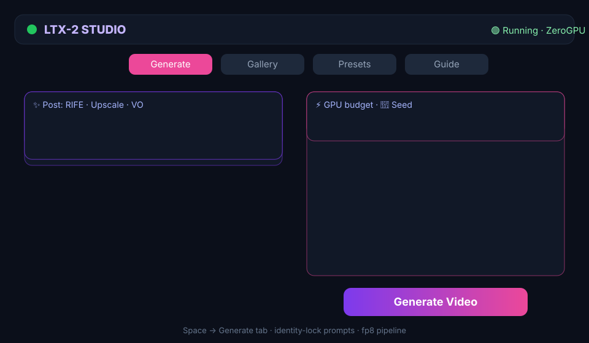
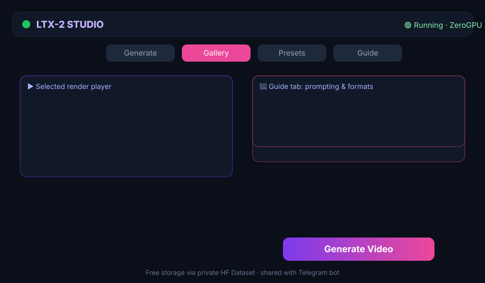
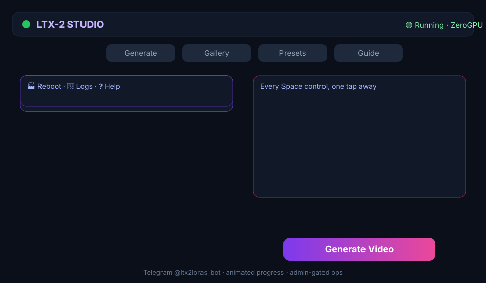
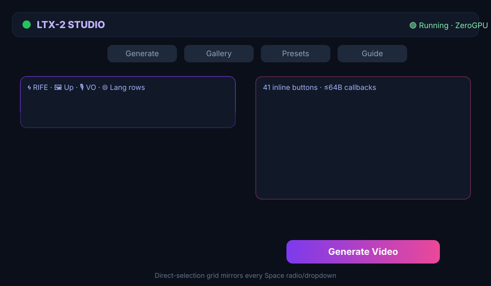
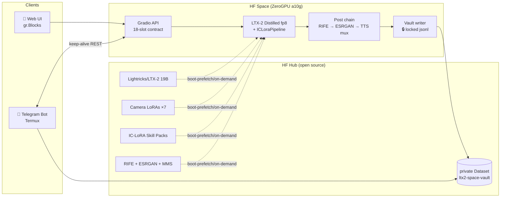
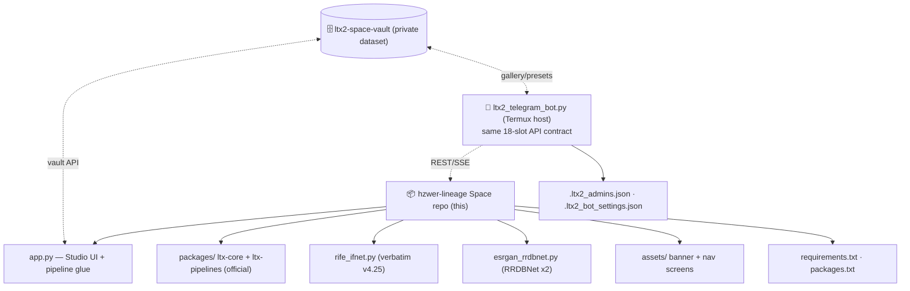
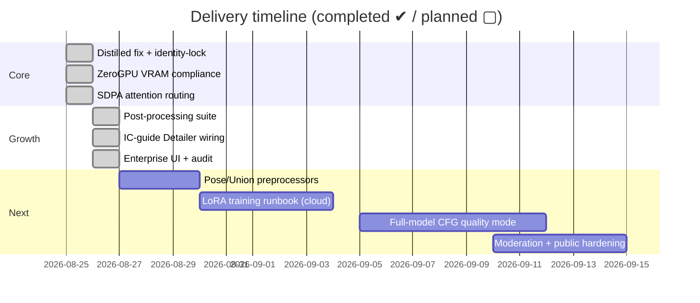

<div align="center">



# LTX-2 STUDIO

### *Every frame tells a story — we direct it.*

**Cinematic Image-to-Video Studio · Identity-Locked Faces · Director Timelines**
*ZeroGPU-native · Telegram-controlled · Enterprise-audited*

[](https://huggingface.co/spaces/tabrezahmed51/LTX-2-LoRAs-Camera-Control-Dolly)
[](https://t.me/ltx2loras_bot)
[](https://huggingface.co/datasets/tabrezahmed51/ltx2-space-vault)
[](LICENSE)

</div>

---

> ⚡ **TL;DR** — Upload a face → get a cinematic animated clip with that exact identity,
> RIFE-smoothed motion, Real-ESRGAN-sharp detail, and an 11-language voiceover —
> from the web UI or a single Telegram caption.

---

## ✨ Feature Constellation

| | Feature | Where |
|---|---|---|
| 🎬 | **I2V / T2V / Director Timelines** (multi-shot stitching) | UI + `#director` bot mode |
| 🔐 | **Identity-Lock prompt engineering** (facial fidelity across frames) | always-on, `#noenhance` to bypass enhancer |
| 🎛 | **Camera-Control LoRAs ×7** (dolly/jib/static) | dropdown / panel buttons / `#cam_*` tags |
| 🧩 | **Skill Packs** — official IC-LoRA stack (Pose·Union·✨Detailer w/ true guide-mode) | dropdown / `#pack_*` |
| 🌀 | **RIFE v4.25 interpolation** — 2× frames, audio-preserving | toggle / `#rife` |
| 🖼 | **Real-ESRGAN ×2 upscale** — tiled, OOM-graceful | toggle / `#up` |
| 🎙 | **MMS-TTS voiceover** — 11 Indic+EN languages, Replace/Mix modes | accordion / `/vonarr` `#vomix` |
| 🎯 | **Stage-1 anchor tuning** (Tight/Balanced/Loose) per official LTX multiscale guide | radio / `#anchor_*` |
| 💾 | **Vault** — every render + presets stored free in a private HF Dataset | Gallery & Presets tabs |
| 🤖 | **Telegram full-parity remote** — 41-button panel, albums, admin-gated ops | @ltx2loras_bot |

## 🧭 App Navigation Tour

| Space → Generate | Space → Gallery & Presets |
|---|---|
|  |  |

| Telegram Menu | Telegram Control Panel (41 buttons) |
|---|---|
|  |  |

*(SVG previews above are vector wireframes of the live neon-dark theme — swap in PNG captures any time under `assets/screens/`.)*

## 🗺 Blueprint — System Architecture



<details><summary><b>ASCII fallback (renders everywhere)</b></summary>

```
 ┌────────┐   18-slot JSON   ┌───────────────────────────────┐
 │ Web UI │ ───────────────▶ │ Gradio /generate_video         │
 └────────┘                  │  ├─ LTX-2 fp8 distilled (S1→S2)│
 ┌────────┐    keep-alive    │  ├─ IC-guide branch (Detailer) │
 │Tele Bot│ ◀──────────────▶ │  ├─ RIFE 2× ─ ESRGAN 2×       │
 └────────┘   session SSE     │  └─ MMS-TTS mux (replace/mix) │
      │                       └──────────────┬────────────────┘
      ▼                                      ▼
 private Dataset VAULT ◀──────────── metadata.jsonl (+ mp4 shards)
```
</details>

## 🏗 Repository Diagram



## 🚀 Quick Start

**Space (zero-setup):** open the Space → Generate tab → drop a portrait → describe motion → Generate.
Pro knobs live in ✨ Post-Processing and Advanced accordions; every control is also a REST slot (18-param contract).

**Telegram remote:**
```bash
termux-wake-lock
pip install requests pillow huggingface_hub
python ~/ltx2_telegram_bot.py          # first /start claims 👑 ownership
/menu                                   # full button console
/photo + caption "slow push-in #up #rife #pack_detail #anchor_balanced"
/vonarr नमस्ते दुनिया                    # attach narration (11 languages)
```

## 🛠 Development Roadmap



✔ **Shipped:** identity-lock engine · fp8 ZeroGPU fit · SDPA routing · IC-guide Detailer · RIFE/ESRGAN/TTS suite · Vault+Presets · 41-button Telegram parity · enterprise audit fixes · keep-alive perf (3.3×)

▢ **Next queue:** control-map preprocessors (depth/pose) → real Pose/Union guides · cloud-GPU LoRA training runbook (LTX Trainer) · full-model CFG path · moderation gate · i18n strings

## 📸 Proof of Work

<details><summary><b>Verification transcript (live runs)</b></summary>

```
[boot] StudioTheme constructed
RIFE weights ready + verified: …/MonsterMMORPG--Practical-RIFE/…/flownet.pkl
ESRGAN x2 weights ready: …/ai-forever--Real-ESRGAN/…/RealESRGAN_x2.pth
IC-guide mode: building reference video…
Enhanced prompt (identity-locked): …
event: complete
[vault] saved runs/2026-08-26/88acb57929.mp4
[post] voiceover (Hindi, Mix over native audio) ok
vault latest pack: "Detailer [IC-guide]" · post: 'rife,upscale,vo:Hindi'
```
</details>

<details><summary><b>Engineering receipts</b></summary>

- Commits: `b46520d` guide-compliance · `0f2ecc0` identity prompts · `18f4691` anti-crop · `0957620` SDPA · `7aceefb` fp8 fit · `32e64d8` post-suite · `94bc09d` weight pairing
- Perf: keep-alive migration **479 ms → 144 ms per call (3.3×)**
- Reliability: strict weight-pairing at boot (feature self-disables on mismatch); OOM tile-retry; poll loop crash-proofed
- Audit trail: enterprise review fixed C-level items — secrets→env, owner-claim auth, admin gates, flood limits
</details>

## 🔐 Security & Licensing

- Secrets read from env first (`TG_BOT_TOKEN` / `HF_TOKEN`) — **rotate the historical tokens** shared during development
- Owner-claim auth on the bot; dangerous ops (`/reboot`, `/reboot?factory`, logs) admin-only; flood caps (1 queued + 1 running/user, global 8, 60 s cooldown)
- Model licenses: base **Apache-2.0** (LTX-2 open weights) · camera LoRAs per Lightricks terms · **MMS-TTS = CC-BY-NC** (non-commercial) · MusicGen alternative available if commercial use is needed

## 📚 References

1. [LTX-2.5 official workflow guide](https://huggingface.co/blog) — multiscale S1/S2 anchor semantics, CFG rules, frame laws
2. [Practical-RIFE (hzwer)](https://github.com/hzwer/Practical-RIFE) + weights [hzwer/RIFE](https://huggingface.co/hzwer/RIFE), mirror [MonsterMMORPG/Practical-RIFE](https://huggingface.co/MonsterMMORPG/Practical-RIFE)
3. [ai-forever/Real-ESRGAN](https://huggingface.co/ai-forever/Real-ESRGAN) — RRDBNet ×2 weights
4. [facebook/mms-tts](https://huggingface.co/facebook/mms-tts-eng) — VITS multilingual TTS
5. [Lightricks IC-LoRAs](https://huggingface.co/Lightricks/LTX-2-19b-IC-LoRA-Detailer) — Pose / Union / Detailer
6. [smart_vision_comfyui_ltx25_director](https://github.com/tabrezahmed51/ui-ux-pro-max-skill) — camera-intent vocabulary inspiration (MIT)
7. Skills DB used for UX audit: ui-ux-pro-max · frontend-design · huggingface-gradio/spaces

## 🙌 Credits

Built on **Lightricks LTX-2** open weights · RIFE by Hzwer · Real-ESRGAN by Xintao Wang · MMS by Meta · ComfyUI director concepts by Smart Vision · Telegram + Gradio integration, identity-lock system, Director timelines, vault layer and audits crafted for **@tabrezahmed51**.

<div align="center">
<sub><i>“Deep-space black canvas. Neon-story pixels.”</i></sub>
</div>
